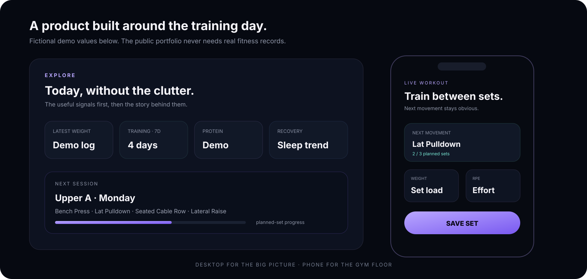
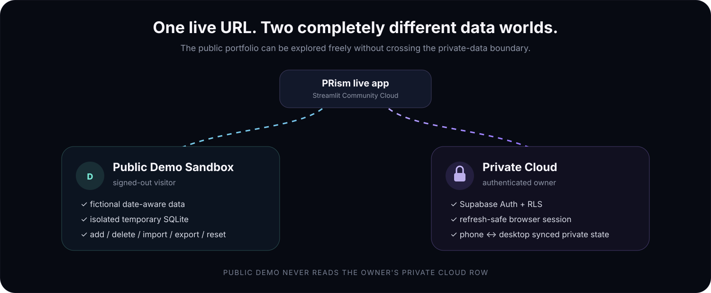

<div align="center">



<br/>

# PRism

### Train with intent. See the pattern.

**A private fitness tracker + live training companion that turns training, nutrition, recovery and progress into one continuous workflow.**

<br/>

[](https://prism-prakhargoyal-0002.streamlit.app/)
[](docs/PORTFOLIO.md)
[](docs/INSTALL_APP.md)

<br/>


<br/>

<sub>Built by <a href="https://github.com/prakhargoyal02"><strong>Prakhar Goyal</strong></a> · <a href="https://www.linkedin.com/in/prakhar-goyal-d2002/">LinkedIn</a></sub>

</div>

---

## ✦ PRism in 30 seconds

| Explore | Live Workout | Manage |
|---|---|---|
| One continuous read-only story of **today → training → nutrition → recovery → progress** | Log every set with **reps, load, RPE, notes, previous performance and rest timer** | Edit plans, meals, sleep, weight, people, backups and CSV imports |
| Next useful action stays visible | Finish or reopen today's workout | Bundle CSV + multi-file CSV import |
| Built for desktop and phone | Designed for between-set use | Duplicate-safe data workflows |

> **Try it without an account:** open the live link while signed out. PRism creates an isolated fictional demo sandbox so the portfolio is fully testable without exposing private fitness data.

---

## 🎬 Product preview

<div align="center">
  
</div>

The preview uses fictional demo values. The interface is deliberately not a generic dashboard. PRism uses an editorial dark-purple visual system, animated data signals, floating system nodes, scroll-led sections and responsive layouts that collapse cleanly for gym use on a phone.

---

## ◈ One system, two data worlds



### 🔷 Public Demo Sandbox

Every signed-out visitor gets a temporary, isolated database containing fictional data.

You can safely:

- explore the complete dashboard;
- use Live Workout;
- add and delete fake records;
- edit the fake weekly plan;
- import one Bundle CSV or several supported CSVs together;
- export demo CSV/ZIP files;
- reset the sandbox.

The repository includes [`sample_data/PRism_Demo_Bundle.csv`](sample_data/PRism_Demo_Bundle.csv) so the data workflow can be inspected without personal information.

### 🔐 Private Cloud

Authenticated PRism is a separate world.

- Supabase Auth controls identity.
- PostgreSQL Row Level Security protects the owner's cloud row.
- SQLite remains the private working database inside the app session.
- Private state syncs across trusted phone/desktop sessions.
- Normal browser refresh/reopen restores the Supabase session without storing the password.
- Public demo code never needs to read the private cloud row.

---

# 🚀 What PRism can do

## 🏋️ Training

- weekly workout-plan structure;
- next-training-day logic;
- set-by-set workout logging;
- custom load on every set;
- reps, RPE and notes;
- previous-performance context;
- planned-set progress;
- rest timer;
- finish workout + reopen/undo completion;
- India-local calendar handling for live sessions.

## ✦ Nutrition

- meals + time of eating;
- calories and macros;
- protein guidance from recorded body weight;
- today/latest-log fallback when nothing has been entered yet;
- CSV portability.

## ◒ Recovery

- sleep duration;
- subjective sleep quality;
- recovery history;
- trend visualization.

## ⌁ Progress

- body-weight history;
- body-weight trend chart;
- exercise personal-record summaries;
- recent training volume/context;
- separate people/profiles.

## ☁️ Cloud + portability

- private Supabase authentication;
- refresh-safe browser session restoration;
- private phone ↔ desktop sync;
- optimistic revision checks to avoid silently overwriting newer cloud state;
- one-file PRism Bundle CSV;
- separate CSV recognition by **columns**, not filename;
- select multiple separate CSVs and import them together;
- duplicate-safe **Add safely** mode;
- replace matching data categories when intentionally requested.

---

# 🧠 Product decisions that matter

PRism is intentionally more than a CRUD demo.

| Decision | Why |
|---|---|
| **SQLite stays the working store** | Fast, portable and simple for local/session state |
| **Supabase sync wraps SQLite** | Adds durable private cloud access without rewriting every feature around remote queries |
| **Public demo is isolated** | Portfolio visitors can touch everything without touching owner data |
| **Two-step login** | Enter on the email field cannot accidentally submit an empty password |
| **Refresh-token restore** | Normal F5/reopen keeps Private PRism usable without saving the password |
| **India timezone in deployment entrypoint** | Cloud server time cannot shift the workout into the previous day |
| **Real row-based weekly layout** | Desktop stays a grid; mobile naturally stacks Monday → Sunday |
| **CSV stays first-class** | Data is still portable even when cloud sync exists |

For the deeper engineering story, read **[the portfolio case study](docs/PORTFOLIO.md)**.

---

# 📦 CSV that does not trap your data

PRism supports two approaches.

### One PRism Bundle CSV

A single portable file can contain:

```text
profile
weights
workouts
meals
sleep
plans
```

using a `record_type` column.

### Separate CSV files

PRism also detects supported profile / weight / workout / meal / sleep / plan CSVs from their **columns**.

On the live app you can select several supported CSVs together and PRism combines them into one import pass.

### Import modes

| Mode | Behavior |
|---|---|
| **Add safely (recommended)** | Keep existing data, add new rows and skip duplicates |
| **Replace matching data type(s)** | Intentionally replace only the selected/matching categories |

---

# 🛠️ Tech stack

| Layer | Technology | Role |
|---|---|---|
| Language | Python 3.12 | Application logic |
| Web UI | Streamlit 1.66.1 | Interactive product + deployment |
| Data | Pandas | Tables, transforms and CSV workflows |
| Working DB | SQLite | Portable local/session data |
| Cloud | Supabase Auth + PostgreSQL | Identity + durable private state |
| Security | Row Level Security | Per-user cloud isolation |
| Visual system | HTML + CSS + SVG | PRism theme, motion and responsive layout |
| Hosting | Streamlit Community Cloud | Public live application |
| Source | GitHub | Versioned portfolio repository |

---

# ⚡ Run locally

### Windows

```powershell
git clone https://github.com/prakhargoyal02/PRism.git
cd PRism
py -m pip install -r requirements.txt
py -m streamlit run app.py
```

### macOS / Linux

```bash
git clone https://github.com/prakhargoyal02/PRism.git
cd PRism
python -m pip install -r requirements.txt
python -m streamlit run app.py
```

Local PRism creates private files such as:

```text
prism.db
csv_backups/
```

They are excluded from Git.

---

# 📱 Use PRism like an app

PRism is deployed as a web app, so there is no fake “native app” claim here.

You can still put it on your phone home screen or desktop for one-tap access:

- **Android Chrome / Brave:** menu → **Add to Home screen** / **Install app**
- **iPhone Safari:** Share → **Add to Home Screen**
- **Windows Chrome / Brave:** create a site shortcut and optionally open it as a window
- **Microsoft Edge:** Apps → **Install this site as an app** when offered

Full steps: **[docs/INSTALL_APP.md](docs/INSTALL_APP.md)**

---

# 🗂️ Repository map

```text
PRism/
├── app.py                       # Main product + local entry point
├── streamlit_app.py             # Live deployment entry point + browser/session fixes
├── database.py                  # SQLite schema + data helpers
├── cloud_sync.py                # Supabase Auth + private-state sync
├── csv_tools.py                 # CSV detection/import/export
├── demo_data.py                 # Fictional date-aware demo generator
├── ui.py                        # Theme, visual components and motion
├── supabase_schema.sql          # RLS-protected cloud schema
│
├── assets/
│   ├── readme_hero.svg          # Animated README hero
│   ├── readme_architecture.svg  # Public/private architecture visual
│   ├── readme_showcase.svg      # Privacy-safe product preview
│   └── ...                      # PRism UI SVG assets
│
├── sample_data/
│   └── PRism_Demo_Bundle.csv
│
├── docs/
│   ├── PORTFOLIO.md             # Project case study / interview walkthrough
│   └── INSTALL_APP.md           # Phone + desktop shortcut guide
│
├── CLOUD_SETUP.md
├── DEPLOYMENT.md
├── HOW_IT_WORKS.md
└── FINAL_CHECKLIST.md
```

---

# 🔒 Security & privacy

The repository intentionally excludes:

```text
*.db
*.sqlite*
csv_backups/
.streamlit/secrets.toml
.env
```

The deployed app uses a Supabase **publishable** key with authentication and RLS. It does not ship a service-role secret.

Browser persistence stores the Supabase refresh session material needed to restore authentication, **not the account password**.

Public visitors receive generated fictional data. Real personal workout, nutrition, sleep, body-weight and CSV records do not belong in this public repository.

---

# 📚 Project docs

| Document | Purpose |
|---|---|
| [Portfolio Case Study](docs/PORTFOLIO.md) | Engineering decisions, bugs solved, interview walkthrough |
| [Install / Home Screen Guide](docs/INSTALL_APP.md) | Launch PRism like an app on phone/desktop |
| [How It Works](HOW_IT_WORKS.md) | Internal flow and product behavior |
| [Cloud Setup](CLOUD_SETUP.md) | Supabase configuration |
| [Deployment](DEPLOYMENT.md) | Streamlit Community Cloud setup |
| [Final Checklist](FINAL_CHECKLIST.md) | Release checks |

---

# 🧩 Current status

```text
LIVE WEBSITE       ✅
PUBLIC DEMO        ✅
PRIVATE CLOUD      ✅
REFRESH LOGIN      ✅
PHONE + DESKTOP    ✅
MULTI-CSV IMPORT   ✅
INDIA DAY ROLLOVER ✅
MOBILE LAYOUT      ✅
```

Core PRism is intentionally treated as stable now. Future work should be additive polish or clearly scoped features rather than risky rewrites.

---

# 👤 Author

**Prakhar Goyal**  
Creator and developer of PRism.

[GitHub](https://github.com/prakhargoyal02) · [LinkedIn](https://www.linkedin.com/in/prakhar-goyal-d2002/) · [Live PRism](https://prism-prakhargoyal-0002.streamlit.app/) · [Project case study](docs/PORTFOLIO.md)

---

## Safety note

PRism is a fitness tracking and education project. Its training, nutrition and recovery guidance is general information and does not diagnose medical conditions or replace a qualified trainer, dietitian or healthcare professional.

---

<div align="center">

### Built around one idea:

**your training data should move together.**

[▶ Open PRism](https://prism-prakhargoyal-0002.streamlit.app/) · [LinkedIn](https://www.linkedin.com/in/prakhar-goyal-d2002/) · [Read the case study](docs/PORTFOLIO.md) · [Install shortcut](docs/INSTALL_APP.md)

<sub>Built by <a href="https://github.com/prakhargoyal02">Prakhar Goyal</a> · Python · Streamlit · SQLite · Supabase · Pandas · Responsive UI</sub>

</div>

